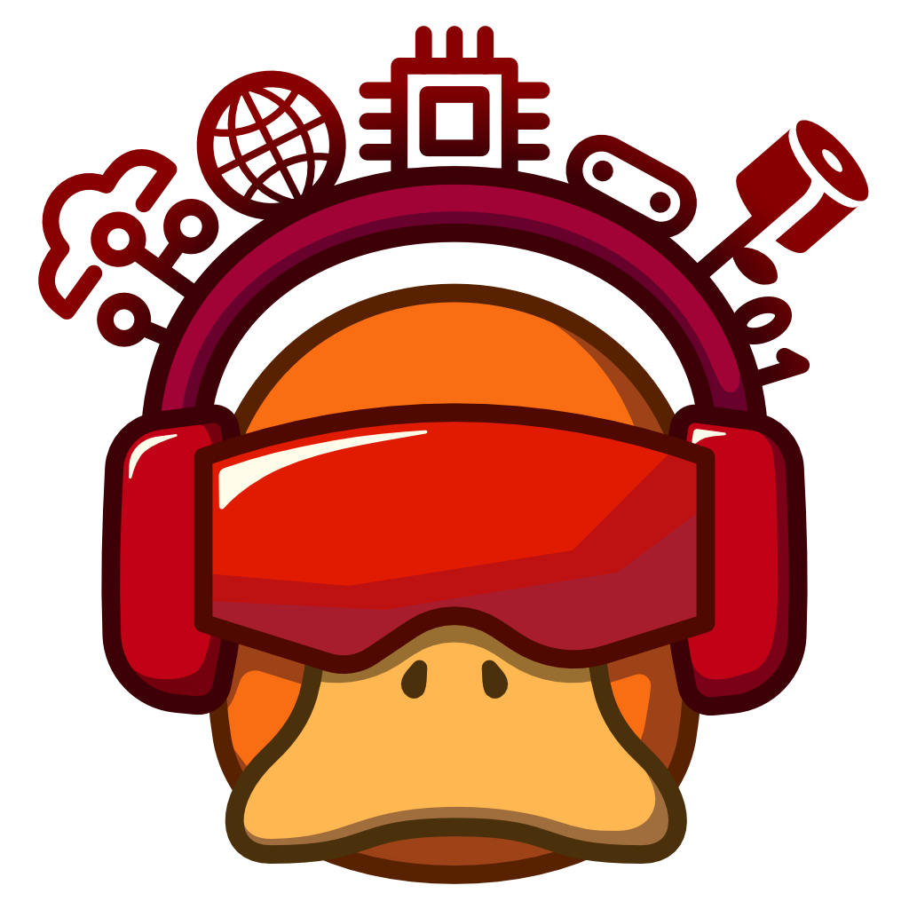

# LUCompSoc Branding

## Logos

There are three variants of the logo provided:
- [Minimal](/logos/minimal) - This should only be used for small use-cases like the website favicon

- [Light](/logos/light) - This is better on light backgrounds

- [Dark](/logos/dark) - This is better on dark backgrounds

### Which Logo Should I Use?

For calrity, you should prioritise using the **light variant** on lighter backgrounds and the **dark variant** on darker backgrounds.

There are 1024 x 1024 pixel and 4096 x 4096 pixel versions available for all variants. In most cases 1024x1024 will be suitable, but 4096x4096 px is provided for the cases when detail matters (e.g. physical merchandise).

### Credits

All of these logo variations were made by [@Tyloxon](https://github.com/Tyloxon) using the [Affinity](https://www.affinity.studio/) program.
